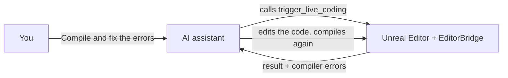

# EditorBridge

**Let your AI assistant work inside the Unreal Editor.**

Coding assistants such as Claude Code, Cursor or Codex can edit your C++, but they cannot press Compile, play the game or look
at the screen. EditorBridge gives them those hands: 46 editor actions they can call themselves while they talk with you.

## What you can ask

- *"Compile the project and fix the errors."*
- *"Start the game, wait 5 seconds, take a screenshot and tell me what you see."*
- *"Click the Options button of the main menu and check that the settings panel opens."*
- *"Import C:/Art/crate.fbx into /Game/Props and generate collision."*
- *"Read the last 200 lines of the log and summarise the warnings."*

## Get started

1. Copy `EditorBridge` into your project's `Plugins` folder (or install it from Fab) and open the project.
2. Connect your assistant (one command for Claude Code, a few lines of settings for Claude Desktop, Cursor or Codex):
   [Docs/AI-Assistants.md](Docs/AI-Assistants.md).
3. Ask.

## What it can do

| Area | Commands |
|---|---|
| Build | Live Coding with the compiler errors |
| Save and logs | save without dialogs, unsaved packages, Output Log |
| Play In Editor | start, stop, screenshot, move the player, list what the camera sees |
| Mouse and keyboard | clicks, drags, mouse wheel and key presses sent to the game |
| Screenshots | editor or game, timed sequences with a contact sheet |
| Import | FBX, textures, sounds |
| Settings and scripts | console commands, CVars, project settings, Python |
| Level | list actors, read and change their properties |

Every command, with its arguments and an example: [Docs/Commands.md](Docs/Commands.md).

## Without an assistant

Any script can use EditorBridge too: write a small JSON request in `Saved/EditorBridge/`, read the JSON answer. See
[Getting Started](Docs/Getting-Started.md).

## Safety

Each family of commands (Python, closing the editor, project settings...) can be switched off in
**Window > Dev Tools > Editor Bridge**. EditorBridge only reads files in your project's `Saved` folder; it opens no network port
and is not included in packaged games.

## Requirements

Unreal Engine 5.7, Windows 64-bit. For assistants: Python 3.9 or newer.

Documentation: [Docs/README.md](Docs/README.md). Copyright (c) 2026 Fabien Lacaze, see `LICENSE.md`.
